<div align="center">


# Модус · веб-приложение

**Рабочее пространство сотрудника, исполнителя, руководителя и администратора**

[Демонстрация](https://modus-trade.makquiz.site) · [Весь проект](https://github.com/Modus-trade/modus) · [Backend](https://github.com/Modus-trade/modus-back)
</div>

React-приложение для обработки проблем и предложений сотрудников. Этот репозиторий содержит интерфейс, клиент API, формы, аналитические экраны и стили. Серверные права, обработка данных, интеграционные секреты и фоновые задания находятся в `modus-back`.

README описывает состояние на **13.11.2026**. Ниже — реальные снимки работающей веб-версии, затем техническая карта проекта и инструкции для разработчика. Числа на снимках демонстрационные и могут отличаться после изменения базы.

## Содержание

- [Быстрый запуск](#быстрый-запуск)
- [Роли и маршруты](#роли-и-маршруты)
- [Возможности сайта](#возможности-сайта)
- [Экран интеграций](#экран-интеграций)
- [Архитектура клиента](#архитектура-клиента)
- [Разработка и сборка](#разработка-и-сборка)
- [Проверка интерфейса](#проверка-интерфейса)
- [Ошибки и диагностика](#ошибки-и-диагностика)
- [Поставка и документация](#поставка-и-документация)

## Быстрый запуск

Нужны Node.js 22+ и работающий backend. В отдельном терминале из `modus-back` запустите API на порту 8000 по [инструкции сервера](https://github.com/Modus-trade/modus-back#-запуск-у-себя).

```sh
git clone https://github.com/Modus-trade/modus-front.git
cd modus-front
npm ci
npm run dev
```

Откройте `http://127.0.0.1:5173`. Vite слушает локальный интерфейс. Три демо-входа после загрузки seed на backend:

| Пользователь | Пароль | Область |
| --- | --- | --- |
| `employee@modus.demo` | `demo1234` | Собственные и назначенные обращения |
| `manager.procurement@modus.demo` | `demo1234` | Отдел закупок и назначенные обращения |
| `admin@modus.demo` | `demo1234` | Весь реестр и администрирование |

Две вкладки одного браузерного профиля разделяют сессию. Для проверки двух ролей одновременно используйте разные профили или приватное окно.

### Другой адрес API

Создайте `.env.local` в корне frontend:

```dotenv
API_TARGET=http://127.0.0.1:8001
```

Перезапустите Vite. Все запросы клиента используют `/api`, а Vite проксирует их и WebSocket на указанный сервер. Это настройка **сервера разработки**: для production аналогичный маршрут настраивается в nginx. В `dist/` нет встроенного backend.

Нельзя помещать вебхуки Битрикса, пароль 1С и ключ ИИ в переменные `VITE_*`: они доступны браузеру. Для браузера достаточно адреса собственного API, авторизации и разрешённых сервером данных.

## Роли и маршруты

| Маршрут | Экран | Кто использует |
| --- | --- | --- |
| `/` | Начальная рабочая область; у администратора центр внимания | Зависит от роли |
| `/overview` | Обзор и аналитика | Руководитель, администратор |
| `/tickets` | Реестр / мои обращения | Авторизованные пользователи в пределах прав |
| `/tickets/:id` | Карточка обращения | Участники с разрешённым доступом |
| `/impact` | Эффект сервиса | Руководитель, администратор |
| `/knowledge` | Инструкции и публикации | Чтение по аудитории, управление по роли |
| `/categories` | Категории и маршрутизация | Администратор |
| `/users` | Пользователи | Администратор |
| `/unassigned` | Нераспределённые обращения | Администратор |
| `/integrations` | 1С и Битрикс24 | Администратор |

Меню адаптировано под роль. Окончательное решение о доступе всегда принимает backend, включая загрузку вложений и запросы аналитики.

## Возможности сайта

### 1. Центр внимания администратора

Начальная страница администратора собирает обращения без ответственного, просроченный первый ответ, просроченное решение и сигналы отсутствия движения. Одно обращение может иметь несколько причин внимания, но в очереди показывается один раз. Фильтры и поиск помогают перейти от общей цифры прямо к проблеме.

Очередь выделяет приоритет и причины цветом и текстом. Строка содержит номер, тему, категорию, статус, исполнителя и последнее действие. Сначала рассматриваются обращения с несколькими причинами внимания, затем более высокий приоритет и давняя активность.

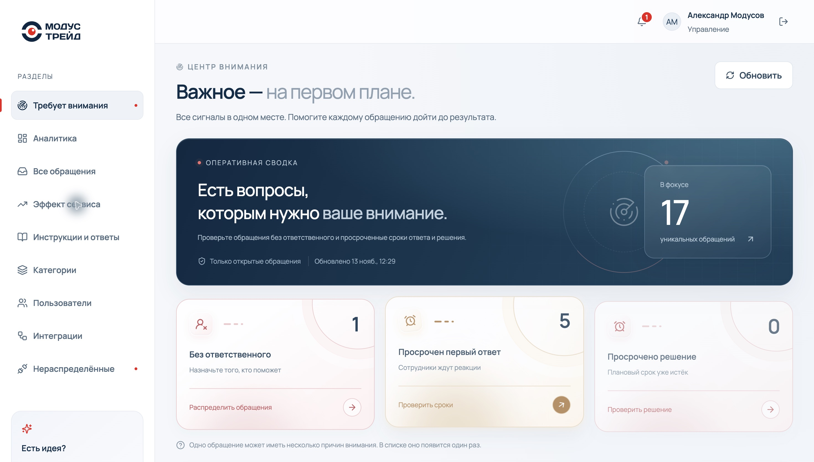

*Центр внимания: сводка и фильтры проблем. Скриншот от 13.11.2026; числа отражают состояние демонстрационной базы на момент съёмки.*

### 2. Подача обращения и помощь до отправки

Сотрудник заполняет тему и описание, выбирает тип и категорию, при необходимости прикладывает файлы и предполагаемое решение. Типы: проблема, предложение и положительный отзыв. Категория определяет исполнителя по умолчанию и срок первого ответа; если исполнитель не настроен, обращение требует распределения.

ИИ-подсказка предлагает тип и категорию по тексту и изображению. Пользователь может исправить выбор. При недоступности ИИ классификация использует правила. Форма также предлагает подходящие опубликованные инструкции: сотрудник может решить вопрос до создания новой заявки и отметить, помогла ли инструкция.

Вложения: PDF, PNG, JPG, DOCX, XLSX, TXT до 10 МиБ на файл. Привязка товара или заказа 1С необязательна. Автор сам решает, делать ли подходящую проблему общей; документ 1С требует приватного обращения.

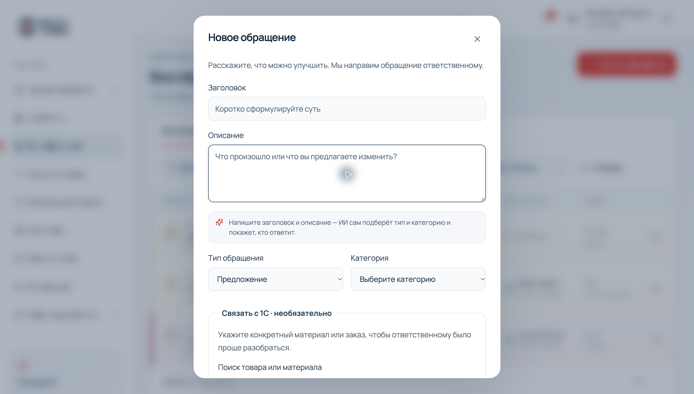

*Форма обращения: описание, классификация и связь с 1С. Скриншот от 13.11.2026; числа отражают состояние демонстрационной базы на момент съёмки.*

### 3. Реестр обращений

Все обращения доступны через единый список с поиском, фильтрами и страницами. Для сотрудника это его рабочая область, для руководителя — доступные входящие, для администратора — общий реестр. Фильтры по статусу, типу и дополнительным параметрам помогают быстро найти конкретную работу.

Цвет обозначает состояние и срочность, но рядом остаётся текстовая подпись. По заголовку или стрелке открывается карточка, а номер позволяет найти то же обращение в уведомлении или интеграции.

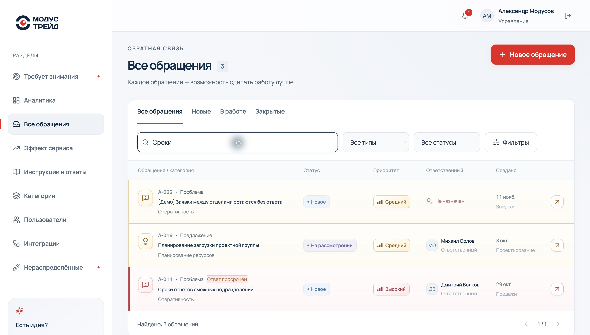

*Реестр обращений и поиск. Скриншот от 13.11.2026; числа отражают состояние демонстрационной базы на момент съёмки.*

### 4. Карточка, обсуждение и история

Карточка объединяет описание, вложения, исполнителя, приоритет, стадии обработки, обсуждение и историю изменений. Ответственный может запросить уточнение, автор — ответить. Голосовые сообщения имеют плеер; при доступном ИИ к ним добавляется расшифровка.

Кнопка «Предложить решение» готовит вспомогательный разбор и черновик ответа. Он не отправляется автоматически. Изменения статуса, исполнителя, приоритета и результата остаются в истории.

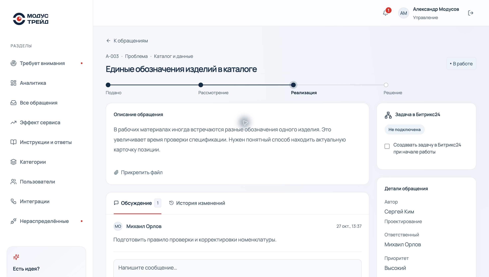

*Карточка обращения A-003 с обсуждением и блоком задачи Битрикс24. Скриншот от 13.11.2026; числа отражают состояние демонстрационной базы на момент съёмки.*

### 5. Сроки и подтверждение результата

Срок первого ответа задаётся категорией. Срок решения назначается отдельно; перенос или снятие установленного срока требует причины. Фоновая проверка напоминает исполнителю о приближении срока решения и сообщает администраторам о просрочке.

«Реализовано» означает, что исполнитель опубликовал результат. Автор подтверждает его — обращение закрывается. Если проблема осталась, автор возвращает результат с пояснением, и работа продолжается. Подтверждается конкретная версия результата: замена текста требует новой проверки. Это позволяет считать проверенные улучшения, а не просто закрытые исполнителем задачи.

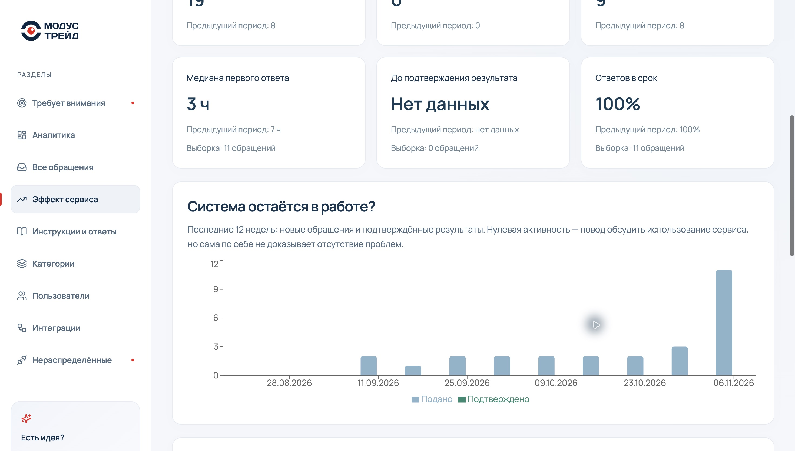

*Подтверждённые результаты и скорость реакции в отчёте эффекта. Скриншот от 13.11.2026; числа отражают состояние демонстрационной базы на момент съёмки.*

### 6. Уведомления внутри системы

Колокольчик показывает непрочитанные события: назначение, комментарий, уточнение, изменение статуса и результат. Нажатие ведёт в нужное обращение. Состояние прочтения хранится на сервере; живые события обновляют интерфейс через WebSocket после сохранения изменения.

При включённой интеграции связанный сотрудник также получает уведомление в Битрикс24. Доставка в портал выполняется отдельной очередью: временная ошибка портала не отменяет обращение в Модусе.

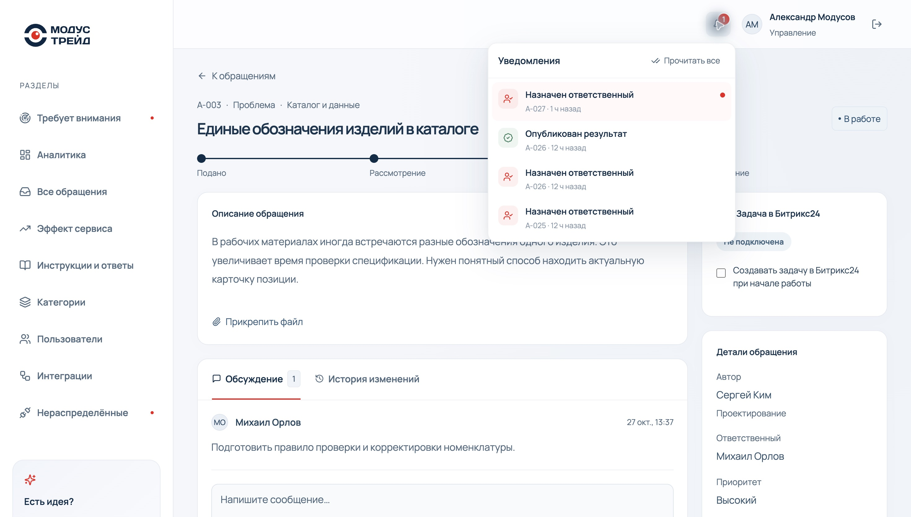

*Колокольчик: назначение и опубликованный результат. Скриншот от 13.11.2026; числа отражают состояние демонстрационной базы на момент съёмки.*

### 7. Инструкции и ответы

Подтверждённое решение можно обобщить в инструкцию: название, условия применения и шаги. Черновик редактируется отдельно от исходного обращения, проходит проверку и публикуется для отдела или компании. Публикация для всей компании требует администратора; для отдела — соответствующего руководителя или администратора.

Проверки отмечают распространённые секреты и персональные данные, но не заменяют редактора. Изменение опубликованной статьи создаёт новый черновик; есть версии, отзывы и жалобы на материал. Поиск инструкций и подсказки в форме подачи помогают уменьшать повторные обращения.

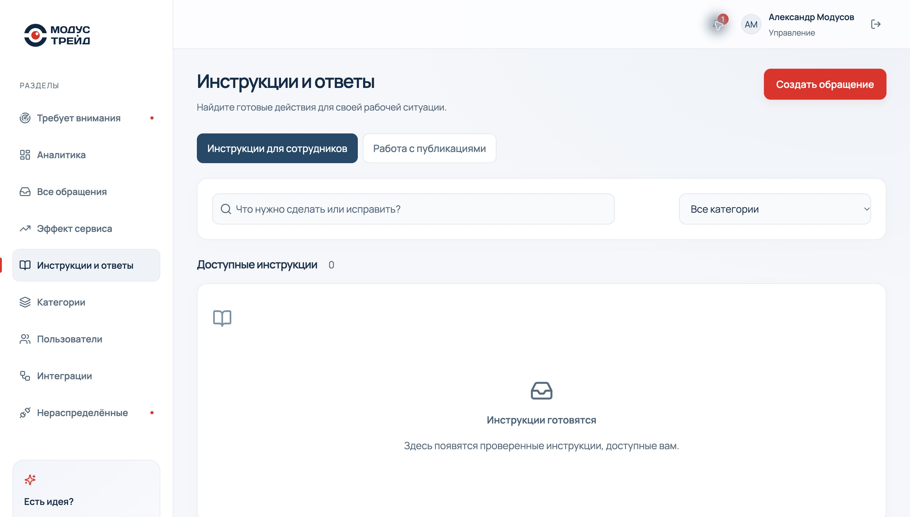

*Каталог инструкций; в снятой локальной базе публикации ещё не подготовлены. Скриншот от 13.11.2026; числа отражают состояние демонстрационной базы на момент съёмки.*

### 8. Общие и повторяющиеся проблемы

Автор может сделать проблему общей. Коллеги присоединяются через бота Битрикс24, вместо создания очередной копии. Счётчик «Столкнулись» включает автора и участников. Аналитика выделяет общие проблемы с несколькими участниками и сортирует их по числу пострадавших.

В текущей веб-форме автоматический поиск похожих общих проблем заменён подсказками инструкций. Общие проблемы и присоединение через бота сохраняются. Система не объединяет приватные обращения автоматически и не раскрывает их текст другим сотрудникам.

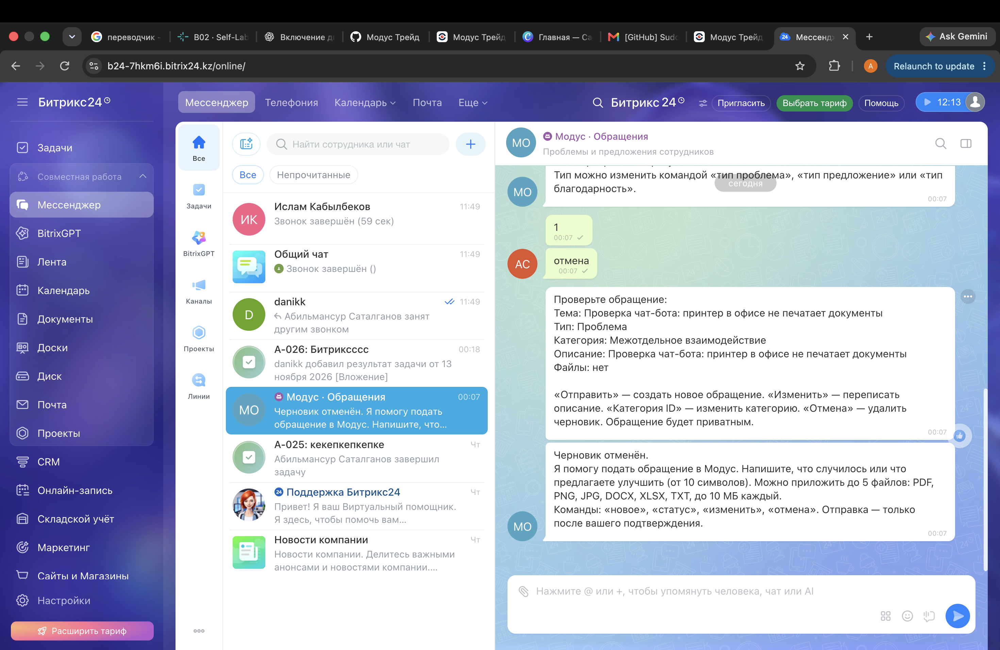

*Бот Битрикс24: диалог подготовки обращения и подтверждение отправки. Скриншот от 13.11.2026; числа отражают состояние демонстрационной базы на момент съёмки.*

### 9. Аналитика текущей работы

Обзор показывает количество обращений, долю закрытых, среднее время первого ответа, просрочки, распределение типов, статусов и категорий. Руководитель получает показатели только доступных ему обращений. Дополнительные блоки показывают повторяющиеся проблемы, результат помощи инструкциями и проблемы по объектам 1С.

«Решил вопрос по инструкции» — самоотчёт пользователя в рамках одной попытки, а не автоматически доказанная экономия времени. Создание обращения в той же попытке меняет её итог.

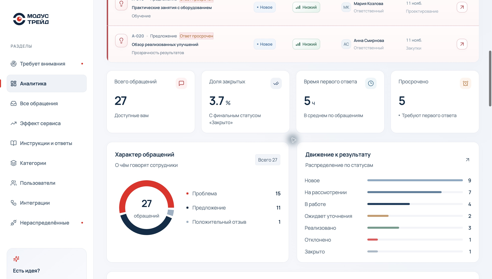

*Обзор: показатели, характер обращений и движение к результату. Скриншот от 13.11.2026; числа отражают состояние демонстрационной базы на момент съёмки.*

### 10. Эффект сервиса

Отдельная страница отвечает на вопрос, что меняется с течением времени. Доступны периоды 30, 60 и 90 дней и сравнение с предыдущим периодом такой же длины.

| Метрика | Как трактовать |
| --- | --- |
| Подано обращений | Созданные за период, а не весь накопленный реестр |
| Результатов подтверждено | Проверенные авторами результаты по дате подтверждения |
| Активные участники | Уникальные авторы новых обращений и комментариев за период |
| Медиана первого ответа | Время от создания до первого ответа для ответов в периоде |
| До подтверждения результата | Медиана времени от создания до подтверждения автором |
| Ответов в срок | Доля своевременных среди состоявшихся первых ответов |
| Незавершённая работа | Текущий остаток, включая реализованные, но ещё не подтверждённые обращения |

Также доступны недельная динамика за 12 недель, разрез по подразделениям и последние подтверждённые результаты со ссылками. При недостаточной истории показано предупреждение. Отсутствующее время обозначается отсутствием данных, а не нулевой длительностью.

Не смешивайте среднее время на общем обзоре с медианой в «Эффекте»: это разные расчёты. Страница показывает наблюдаемую динамику; данных до внедрения и расчёта денежного ROI в MVP нет.

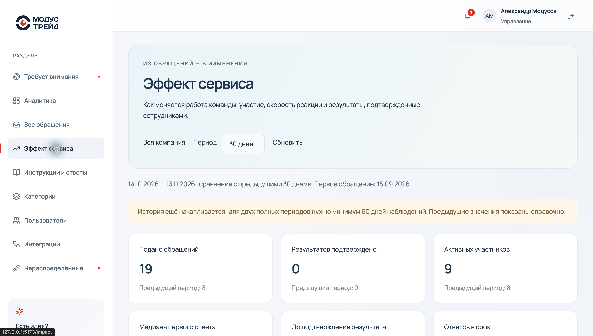

*Эффект сервиса: сравнение периодов и полнота истории. Скриншот от 13.11.2026; числа отражают состояние демонстрационной базы на момент съёмки.*

### 11. Настройка процессов

Администратор управляет категориями, исполнителем по умолчанию и SLA первого ответа. Отдельно управляются пользователи, подразделения, роли и активность аккаунта. Деактивация сохраняет историю работы.

В карточке есть демонстрационные рекомендации исполнителей. Балл учитывает смоделированные опыт, успешность и загрузку с весами 50/30/20. Это **пример интерфейса, а не измерение эффективности людей и не вероятность успешного решения**. Назначение выбирает человек и сохраняет отдельно.

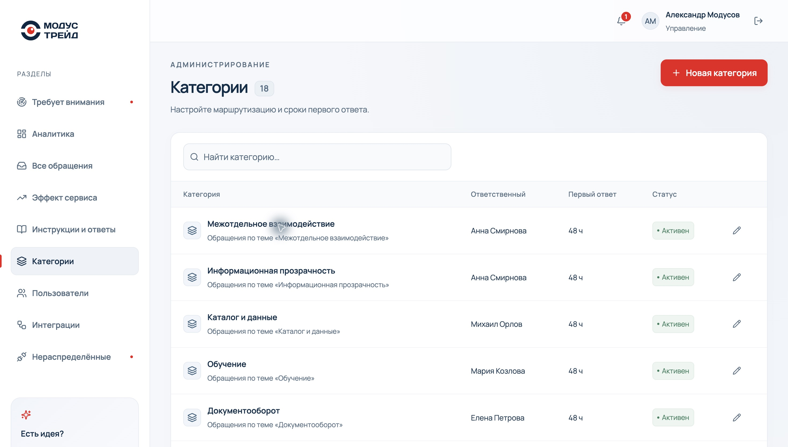

*Категории: маршрутизация и срок первого ответа. Скриншот от 13.11.2026; числа отражают состояние демонстрационной базы на момент съёмки.*


## Экран интеграций

### Битрикс24

Администратор выбирает `real / mock / off`, проверяет связь, импортирует сотрудников и оргструктуру, сопоставляет аккаунты и смотрит журнал. Панель бота показывает регистрацию и состояние опроса. В карточке обращения отдельно включается создание связанной задачи при начале работы.

Результат завершённой задачи возвращается в Модус на подтверждение автором. Обновление асинхронное: экран не должен обещать мгновенный ответ внешнего портала. Статус доставки позволяет отличить ожидание от ошибки.

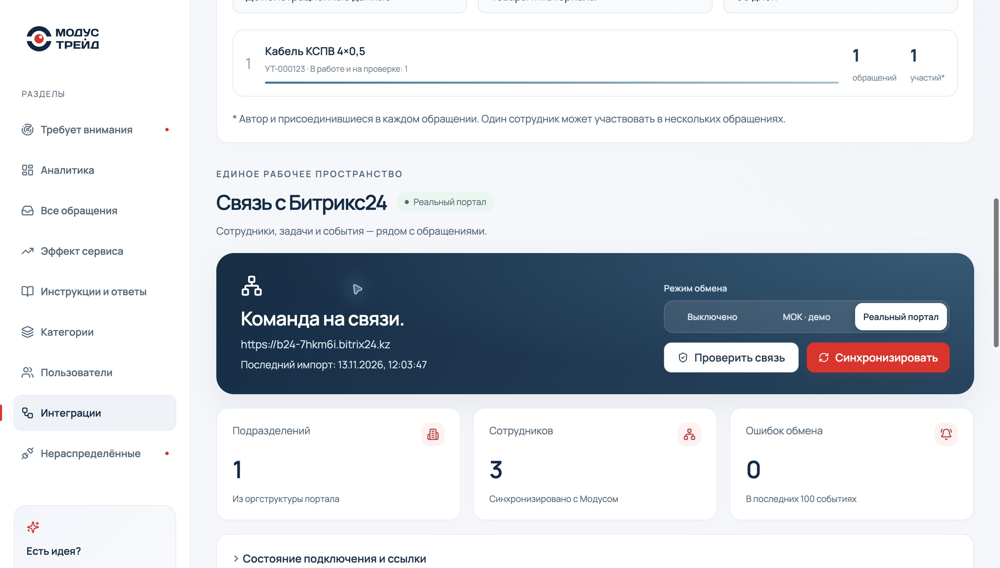

*Режим обмена и состояние Битрикс24. Скриншот от 13.11.2026; числа отражают состояние демонстрационной базы на момент съёмки.*

### 1С

Панель содержит режим, проверку, ручной импорт, счётчики каталога и журнал. В форме обращения `OneCItemPicker` позволяет найти товар и документ. В аналитике `OneCAnalytics` показывает проблемные товары и поставщиков с переходом в связанные обращения.

Демо и реальные данные разделены. Привязка документа требует приватности обращения. Настоящая база пока не подключена: backend содержит адаптер, который предстоит проверить на публикации заказчика. Форма ввода пароля 1С на сайте не реализована — адрес и учётные данные задаются на сервере.

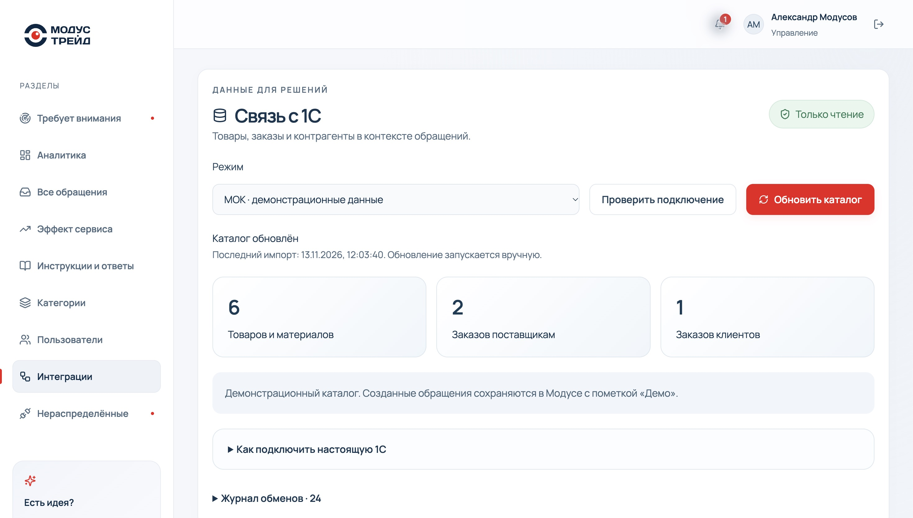

*Каталог и управление интеграцией 1С. Скриншот от 13.11.2026; числа отражают состояние демонстрационной базы на момент съёмки.*

## Архитектура клиента

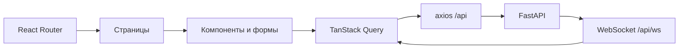

| Технология | Зачем нужна |
| --- | --- |
| React 18 + TypeScript | Компоненты и типы данных |
| React Router | Навигация между рабочими экранами |
| TanStack Query | Загрузка, кэш и повторное получение серверных данных |
| axios | Общий HTTP-клиент |
| React Hook Form + Zod | Формы и клиентская проверка значений |
| Recharts | Диаграммы аналитики |
| Lucide | Иконки действий и состояний |
| Tailwind и CSS | Светлая палитра, адаптация, состояния и анимации |
| Vite | Разработка, прокси и production-сборка |

### Карта файлов

```text
src/
  App.tsx                   оболочка, авторизация, роли и маршруты
  Dashboard.tsx             обзор, статистика и тематические блоки
  Tickets.tsx               список, фильтры и новая заявка
  TicketDetail.tsx          обсуждение, история и управление
  Attention.tsx             очередь внимания администратора
  Impact.tsx                сравнение периодов и подтверждённые результаты
  KnowledgeBase.tsx         чтение и управление инструкциями
  Administration.tsx        пользователи и категории
  Integrations.tsx          управление Битрикс24 и блоки интеграций
  lib.ts                    API-клиент и модели клиента
  realtime.ts               обработка живых событий
  components/
    NotificationBell.tsx    события и непрочитанные
    SmartHint.tsx           подсказка типа и категории
    AssigneeRecommendations.tsx  демонстрационный подбор исполнителя
    KnowledgeSuggestions.tsx     помощь до отправки
    KnowledgePublisher.tsx       публикация решения как инструкции
    KnowledgeEffect.tsx         результат самообслуживания
    ResolutionDeadline.tsx      срок решения
    ResolutionReview.tsx        проверка результата автором
    TicketInsights.tsx          предложенное ИИ решение
    VoiceMessage.tsx            голос в обсуждении
    JoinedProblems.tsx          общие проблемы пользователя
    BitrixTask.tsx              связанная задача
    BitrixBotPanel.tsx          управление ботом
    OneCPanel.tsx               состояние 1С и импорт
    OneCItemPicker.tsx          выбор товара и документа
    OneCAnalytics.tsx           рейтинг по объектам 1С
public/                         логотип, favicon, шрифты
tests/                          тесты клиента
docs/screenshots/               изображения для этого README
vite.config.ts                  порт, прокси и группы bundle
```

### Принципы изменения интерфейса

1. Изменяйте типы вместе с контрактом API. Новое поле должно корректно вести себя на пустой или старой записи.
2. После мутации обновляйте соответствующие запросы TanStack Query; живое событие не заменяет успешный ответ операции.
3. Сохраняйте состояния загрузки, отсутствия данных и ошибки с повтором.
4. Не скрывайте смысл только цветом: нужны текст статуса, подпись и доступное название действия.
5. Проверяйте длинные русские названия, пустой результат фильтра и узкий экран.
6. Для рекомендаций и моков сохраняйте явную маркировку демонстрационных данных.
7. Не переносите серверные ограничения в один frontend: API обязан проверить их самостоятельно.

## Разработка и сборка

| Команда | Результат |
| --- | --- |
| `npm ci` | Установка точных зависимостей по lock-файлу |
| `npm run dev` | Vite с горячей перезагрузкой, порт 5173 |
| `npm test` | Тесты из `tests/*.test.mjs` |
| `npm run build` | `tsc -b`, затем production-сборка Vite в `dist/` |
| `npm run preview` | Просмотр собранных статических файлов; API нужно подключать отдельно |

В production веб-сервер должен отдавать `index.html` для маршрутов SPA и проксировать `/api` в FastAPI, включая Upgrade для `/api/ws`. При публикации сначала выкладываются новые assets, затем `index.html`, чтобы пользователь не получил ссылку на ещё не загруженный файл.

## Проверка интерфейса

| Сценарий | Что проверить |
| --- | --- |
| Вход / выход | Роль и меню соответствуют пользователю; после выхода закрытая карточка недоступна |
| Создание | Проверка обязательных полей, ИИ-подсказка, инструкции, вложения и ошибки API |
| Список | Поиск, фильтры, пустое состояние, страницы и возврат из карточки |
| Обработка | Уточнение, комментарии, голос, назначение, история |
| Срок | Назначение, перенос с причиной и сохранение после обновления страницы |
| Результат | Публикация → подтверждение или возврат автором |
| Уведомления | Счётчик, прочтение, переход и обновление во втором окне |
| Общая проблема | Ограниченное представление участника, без приватных комментариев |
| Знания | Доступность опубликованных статей нужной аудитории |
| Интеграции | Различие мок/реальный/выключено, журнал ошибок, сохранение старых привязок |
| Эффект | 30/60/90 дней, отсутствие выборки и неполная история |
| Адаптация | Длинный текст, клавиатура, узкий экран, читаемые подписи |

## Ошибки и диагностика

| Симптом | Что проверить |
| --- | --- |
| Вход не работает | `http://127.0.0.1:8000/api/health`, запущен ли backend, установлен ли seed |
| 403 при изменении | Роль и `ALLOWED_ORIGINS` backend; адрес сайта должен совпадать |
| «Не удалось загрузить данные» | Network в DevTools: путь, HTTP-статус и ответ API; затем серверный лог |
| 422 на новом endpoint | Совпадение версий backend/frontend и формат параметров запроса |
| Нет живых обновлений | Соединение `/api/ws`, ws-прокси Vite/nginx и авторизация |
| На локальном сайте другие данные | Локальная SQLite и production-база независимы; проверьте `API_TARGET` |
| Реальный Битрикс не работает | Серверный вебхук, права и журнал интеграции; не исправляется frontend-ключом |
| Порт 5173 занят | Завершите прежний Vite в его терминале; конфигурация использует `strictPort` |

## Поставка и документация

Исходный frontend изменяется здесь. Push в `main` запускает GitHub Actions: тесты, сборку, выкладку сайта и копирование в `Modus-trade/modus/frontend`. Не редактируйте зеркало вместо исходного репозитория. Статус каждого этапа виден в Actions.

Снимки в `docs/screenshots/` включены в репозиторий, поэтому README не зависит от временных внешних ссылок. После существенного изменения экрана обновите изображение и подпись. Не добавляйте в снимки пароли, вебхуки и персональные данные рабочей компании.

- [Общее описание и мобильный клиент](https://github.com/Modus-trade/modus)
- [API и установка сервера](https://github.com/Modus-trade/modus-back)
- [Битрикс24: настройка и проверка](https://github.com/Modus-trade/modus-back/blob/main/BITRIX24.md)
